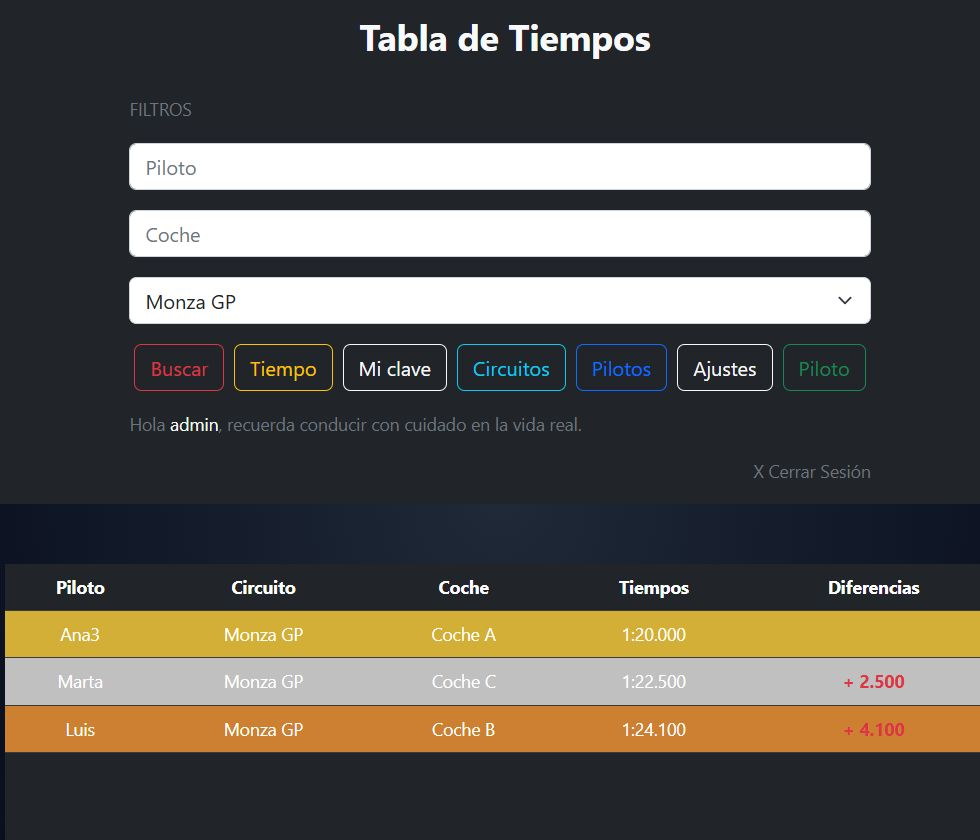

<h1 align="center">Tabla de Tiempos</h1>

<p align="center">
  Registra, compara y comparte los tiempos de vuelta de tus pilotos.
</p>

<p align="center">
  
  
  
  
  
  
</p>

<p align="center">
  <a href="https://github.com/adrianllorian/TablaTiempos/releases/latest/download/tabla-tiempos.jar">
    
  </a>
</p>

<p align="center">
  <strong>Java 17+ · 41,5 MB · Windows / Linux / macOS</strong>
</p>

---

## Vista previa

<p align="center">
  
</p>

## Características

- **Primer arranque**: crea el administrador y, si quieres, el **título**, el
  **logo** y la **foto de fondo** de la aplicación.
- **Ajustes**: el administrador puede cambiar el título, el logo y el fondo
  cuando quiera.
- **Administrador**: crea, edita y borra circuitos; inscribe, edita y borra
  pilotos; puede editar y borrar cualquier tiempo.
- **Pilotos**: inician sesión, registran y editan sus tiempos. No pueden borrar.
- Tabla ordenada con la diferencia respecto al primer puesto.
- **Filtros automáticos**: al cambiar piloto, coche o circuito la tabla se
  actualiza sola.
- Foto opcional asociada a cada tiempo.
- **H2 embebido**: la base de datos se crea sola, sin instalar MySQL.
- Diseño responsive con Bootstrap.

## Descarga

Descarga siempre la última versión desde este enlace fijo:

**[Tabla de Tiempos (última versión)](https://github.com/adrianllorian/TablaTiempos/releases/latest/download/tabla-tiempos.jar)**

- Archivo: `tabla-tiempos.jar`
- Tamaño: 41,5 MB
- Requisito: **Java 17 o superior**
- Plataforma: Windows, Linux y macOS
- No necesita base de datos externa: H2 va incluido.

### Verificar la descarga

SHA-256 del JAR:

```text
2DF05F96B33A4C8B837E3F5911F5F51692169FA0CBD1287548AD7BF048D9A85E
```

Para comprobarlo en PowerShell:

```powershell
Get-FileHash ".\tabla-tiempos.jar" -Algorithm SHA256
```

## Ejecutar

1. Descarga `tabla-tiempos.jar` y colócalo en una carpeta donde puedas escribir.
2. Necesitas **Java 17 o superior** (<https://adoptium.net>).
3. Arranca con doble clic en el JAR o desde una consola:

```bash
java -jar tabla-tiempos.jar
```

4. El navegador se abre solo. Si no se abre, entra en:

```text
http://localhost:8080
```

En Windows también puedes usar `start.bat`; en Linux / macOS, `start.sh`.

Para detener el servidor, pulsa `Ctrl + C` en la terminal.

### Primer arranque

La primera vez verás la pantalla de **Configuración inicial**:

- Usuario y contraseña del administrador.
- Título de la aplicación (opcional).
- Logo y fondo (opcionales).

Después, entra con el administrador y prepara la aplicación:

- **Circuitos** → crear, editar y borrar circuitos.
- **Piloto** → inscribir pilotos.
- **Ajustes** → cambiar título, logo o fondo.

Cada piloto inicia sesión con su cuenta y registra tiempos con **Tiempo**.

Si quieres empezar de cero, para la aplicación y borra la carpeta `data/` que
está junto al JAR. En el siguiente arranque volverá a pedir crear el administrador.

## Roles

| Acción | Administrador | Piloto |
|---|---|---|
| Crear, editar y borrar circuitos | ✅ | ❌ |
| Inscribir, editar y borrar pilotos | ✅ | ❌ |
| Registrar tiempos | ✅ | ✅ |
| Editar sus propios tiempos | ✅ | ✅ |
| Editar tiempos de otros | ✅ | ❌ |
| Borrar tiempos | ✅ | ❌ |
| Consultar y filtrar tiempos | ✅ | ✅ |
| Cambiar su propia contraseña | ✅ | ✅ |
| Cambiar título, logo y fondo | ✅ | ❌ |

> Un circuito o un piloto **no se pueden borrar** si tienen tiempos
> registrados. Tampoco se puede borrar una cuenta de administrador.

## Datos y copias de seguridad

La aplicación crea una carpeta **`data/` junto al JAR** y guarda ahí todo lo
que necesita:

- Base de datos: `data/tabla-tiempo.mv.db`
- Fotos de los tiempos: `data/uploads/`
- Logo y fondo: `data/uploads/settings/`

Se crea sola en el primer arranque, da igual desde qué carpeta ejecutes el
JAR: siempre usa el `data/` que está a su lado.

- **Para mover la aplicación sin perder nada**: mueve el JAR **junto con su
  carpeta `data/`**.
- **Si mueves solo el JAR**: empieza de cero, como si formatearas. La carpeta
  `data/` vieja se queda donde estaba.
- **Copia de seguridad**: con la aplicación parada, copia la carpeta `data/`
  completa.
- **Reset**: con la aplicación parada, borra la carpeta `data/`.
- **Ubicación**: usa una carpeta donde puedas escribir (Escritorio,
  Documentos, un USB...). En `Program Files` no se puede crear `data/`.
- No subas la carpeta `data/` a GitHub.

## Configuración

| Variable | Descripción | Por defecto |
|---|---|---|
| `SERVER_PORT` | Puerto HTTP | `8080` |
| `ABRIR_NAVEGADOR` | Abrir el navegador al arrancar | `true` |
| `JWT_SECRET` | Clave para firmar los tokens (opcional) | se genera sola |
| `MAX_FILE_SIZE` | Tamaño máximo de foto | `10MB` |

> No hay que configurar nada: cada instalación genera su propia clave JWT y la
> guarda en la base de datos. Solo si quieres fijarla, define `JWT_SECRET`.

> El logo y el fondo admiten imágenes de hasta **2 MB**.

Ejemplo en Windows:

```bat
set SERVER_PORT=9090
java -jar tabla-tiempos.jar
```

En Linux / macOS:

```bash
SERVER_PORT=9090 java -jar tabla-tiempos.jar
```

## Compilar desde el código

Requisitos: **JDK 17+** y el Maven Wrapper incluido.

```bash
./mvnw clean package
```

En Windows:

```bat
mvnw.cmd clean package
```

El JAR se genera en `target/tabla-tiempos.jar`.

### Publicar una release

Las releases se publican a mano, para adjuntar siempre el fichero que se ha
probado:

1. Compila el JAR.
2. En GitHub, entra en **Releases → Draft a new release**.
3. Crea el tag de la versión (por ejemplo `v1.4.0`) y adjunta `tabla-tiempos.jar`.
4. Publica la release.

El workflow `build.yml` solo comprueba que el proyecto compila en cada push y
pull request; no publica nada.

## Estructura del proyecto

```text
TablaTiempos/
├── src/main/java/            # backend Spring Boot
├── src/main/resources/
│   ├── static/               # CSS, JS e imágenes
│   ├── templates/            # vistas Thymeleaf
│   └── application.properties
├── docs/screenshot.jpeg
├── mvnw / mvnw.cmd
├── start.bat
├── start.sh
├── pom.xml
├── LICENSE
└── README.md
```

## Tecnologías

| Capa | Tecnología |
|---|---|
| Lenguaje | Java 17 |
| Framework | Spring Boot 2.5.6 |
| Seguridad | Spring Security + JWT + BCrypt |
| Persistencia | Spring Data JPA + H2 |
| Vistas | Thymeleaf |
| Frontend | Bootstrap 5 + jQuery |

## Seguridad

- Pensada para usarse en local o en una red de confianza.
- Si la vas a exponer a Internet, ponla detrás de un proxy con HTTPS y cambia
  la contraseña del administrador.
- Las contraseñas se guardan cifradas con BCrypt.
- No subas la carpeta `data/` a GitHub.

## Licencia

Distribuido bajo **MIT License**. Consulta [LICENSE](LICENSE).

---

<p align="center">
  Copyright © 2026 Adrian Llorian
</p>
